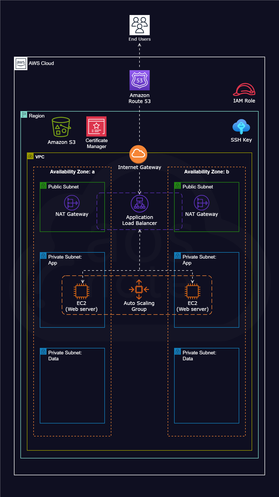
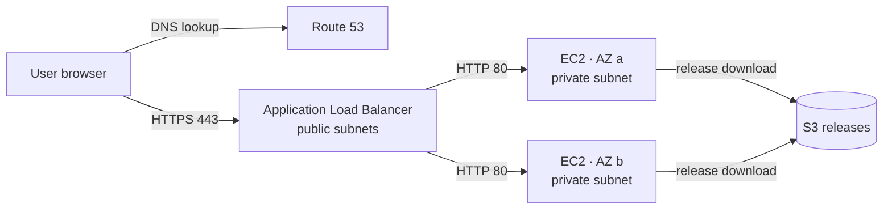

# TechMax Web Platform

Highly available AWS infrastructure for the TechMax web application, provisioned with Terraform and deployed through GitHub Actions.

> **Project status:** In progress. Stage 1 (Git and GitHub), Stage 2 (Terraform bootstrap), and Stage 4 (security and quality checks) are complete. Stage 3 is in progress: the shared VPC module is released as `v1.0.0` in [platform-terraform-modules](https://github.com/dragana1986/platform-terraform-modules), and the development environment is built from it. Completed work is marked ✅ in the [Roadmap](#roadmap). Everything else describes the target design.

---

## Overview

TechMax's web application currently runs in a legacy single-server environment. A server failure or a failed deployment makes the whole application unavailable, and the server can't be rebuilt the same way twice.

This project moves the application to a highly available architecture on AWS:

- **Availability:** the application runs across two Availability Zones behind an Application Load Balancer, so it stays available if one Availability Zone fails.
- **Consistency:** every resource is defined in Terraform and stored in Git, so the complete infrastructure can be recreated at any time.
- **Controlled change:** every change goes through a pull request, automated checks, and approval before it reaches production.
- **Security:** application servers run in private subnets with no public IP addresses, and access to AWS uses IAM roles instead of stored access keys.

---

## Architecture



| Layer | AWS service | Purpose |
|---|---|---|
| DNS | Amazon Route 53 | Resolves the domain name to the load balancer |
| TLS | AWS Certificate Manager (ACM) | Provides the HTTPS certificate |
| Load balancing | Application Load Balancer | Decrypts HTTPS traffic and routes requests to healthy instances |
| Compute | Amazon EC2 + Auto Scaling Group | Runs Apache web servers across two Availability Zones |
| Networking | VPC, public and private subnets, Internet Gateway, NAT Gateways | Isolates the servers and controls traffic |
| Storage | Amazon S3 | Stores versioned application releases |
| Access | AWS IAM roles | Grants instances and the pipeline only the permissions they need |

### User request flow



1. Route 53 resolves the domain name to the Application Load Balancer.
2. The load balancer redirects HTTP to HTTPS and decrypts the traffic using the ACM certificate.
3. The request is forwarded to a healthy EC2 instance in a private subnet. The instance's security group accepts traffic only from the load balancer.
4. Apache serves the web application, and the response returns through the load balancer.

---

## Technology stack

| Area | Tools |
|---|---|
| Version control | Git, GitHub (trunk-based development, protected `main` branch) |
| Infrastructure as Code | Terraform (remote state in S3 with state locking; shared modules from a separate, versioned repository) |
| CI/CD | GitHub Actions with OIDC authentication to AWS |
| Code quality and security | `terraform fmt`, `terraform validate`, TFLint, Trivy |
| Web server | Apache HTTP Server on Amazon Linux |
| Monitoring | Amazon CloudWatch (Prometheus and Grafana to be evaluated) |

---

## Repository structure

```text
techmax-web-platform/
├── app/
│   └── techmax/          # Web application source files (current release)
├── scripts/
│   └── deploy.sh         # EC2 bootstrap script: installs Apache and deploys the release from S3
├── docs/
│   └── reference-architecture.png
├── terraform/            # Infrastructure as Code
│   ├── bootstrap/        # S3 remote state bucket and backend configuration
│   └── environments/
│       └── dev/          # Development environment, built from the shared VPC module (v1.0.0)
└── README.md
```

## Terraform modules

The infrastructure is built from reusable modules that live in a separate repository, [platform-terraform-modules](https://github.com/dragana1986/platform-terraform-modules). The modules are shared with other projects, so they have their own pull requests, automated checks (format, validate, TFLint, and Trivy), and protected release tags.

Each environment references a module by its released version tag, never by a branch:

```hcl
module "vpc" {
  source = "git::ssh://git@github.com/dragana1986/platform-terraform-modules.git//vpc?ref=v1.0.0"

  name       = local.name
  cidr_block = local.cidr_block
}
```

| Module | Version used | Used by |
|---|---|---|
| `vpc` | `v1.0.0` | Development |

**Upgrading a module:** change the `ref` tag in one environment through a pull request, review the plan, and apply. Environments are upgraded in order: development, then staging, then production.

---

---

## Environments

| Environment | Purpose | VPC CIDR | State key | NAT Gateways | Deployment approval | Status |
|---|---|---|---|---|---|---|
| Development | Testing changes | `10.10.0.0/16` | `dev/terraform.tfstate` | 1 (cost-optimized) | Automatic | ✅ VPC built |
| Staging | Pre-production validation | `10.20.0.0/16` | `staging/terraform.tfstate` | 2 | Automatic | ⬜ Planned |
| Production | Live traffic | `10.30.0.0/16` | `prod/terraform.tfstate` | 2 (one per Availability Zone) | Manual approval required | ⬜ Planned |

Each environment has its own folder under `terraform/environments/`, its own state file and lock in the shared state bucket, and a non-overlapping CIDR block from the environment IP plan.

---

## Release management

Releases follow semantic versioning (`MAJOR.MINOR.PATCH`). Each release is a Git tag on `main`, and the pipeline packages that exact commit to S3.

| Version | Release |
|---|---|
| `v1.0.0` | TechMax web application, the initial production release |
| `v2.0.0` | Redesigned web application (Jupiter) |

Rollback is done by reverting the faulty commit through a pull request, or by redeploying the previous release tag.

---

## Contribution workflow

1. Create a short-lived feature branch from `main`, for example `feature/vpc-module`.
2. Commit focused changes using [Conventional Commits](https://www.conventionalcommits.org/) prefixes (`feat:`, `fix:`, `chore:`).
3. Open a pull request against `main`.
4. Automated checks run, and at least one reviewer approves.
5. Merge into `main`. Production deployments require an additional manual approval.

---

## Security practices

- Secrets, SSH keys, Terraform state, and `.tfvars` files are excluded through `.gitignore`.
- The `main` branch is protected: pull requests, approvals, and passing checks are required, and force pushes are blocked.
- GitHub secret scanning with push protection blocks credentials before they reach the repository.
- EC2 instances have no public IP addresses, and administrative access uses AWS Systems Manager Session Manager instead of SSH.
- The pipeline authenticates to AWS through OIDC and an IAM role, so no long-lived access keys are stored in GitHub.

---

## Roadmap

| Stage | Scope | Status |
|---|---|---|
| 1 | Git and GitHub: repository, branching, pull requests, versioning | ✅ Complete |
| 2 | Terraform bootstrap: S3 remote state, locking, encryption | ✅ Complete |
| 3 | Terraform modules and dev, staging, and production environments | 🟡 In progress: VPC module `v1.0.0` released, development environment built; staging and production follow once the pipeline is in place |
| 4 | Security and quality: `terraform fmt`, `validate`, TFLint, Trivy as required checks | ✅ Complete: required checks run on every pull request in both repositories |
| 5 | CI/CD with GitHub Actions: OIDC authentication, plan on every pull request, apply with approvals | ⬜ Planned |
| 6 | AWS infrastructure: subnets, route tables, Internet and NAT Gateways, IAM, security groups, EC2, load balancer, Auto Scaling | ⬜ Planned |
| 7 | Deployment and recovery: versioning, rollback, blue-green | ⬜ Planned |
| 8 | DNS, HTTPS, and storage: Route 53, ACM, EBS | ⬜ Planned |
| 9 | Containers: evaluate Docker with ECS or EKS | ⬜ To be evaluated |
| 10 | Monitoring: CloudWatch dashboards, alarms, and logs (Prometheus and Grafana to be evaluated) | ⬜ Planned |
| 11 | Production readiness: scaling, backups, disaster recovery, cost | ⬜ Planned |

---

## Author

**Dragana** · Cloud Engineer · [GitHub](https://github.com/dragana1986)
